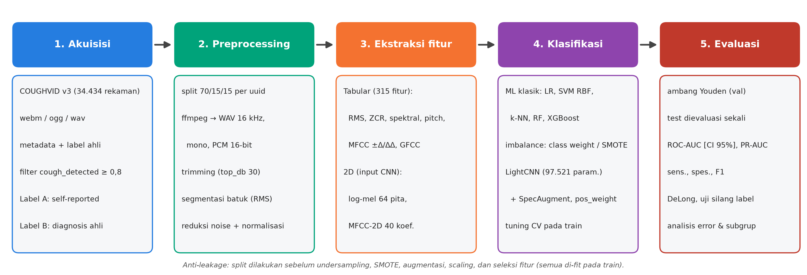
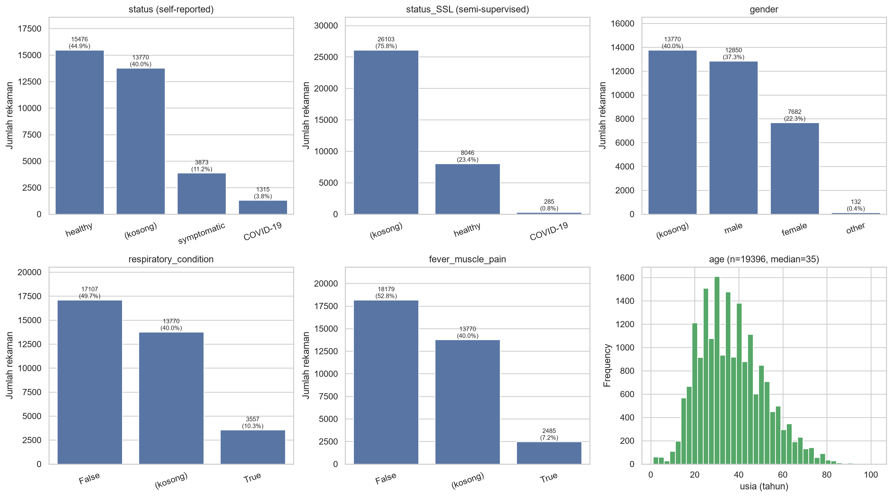
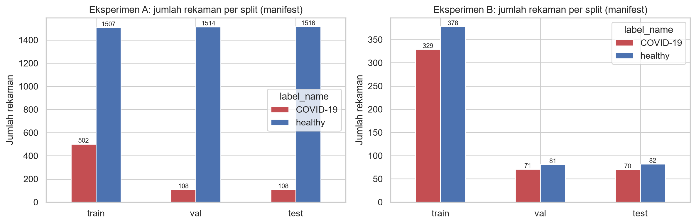
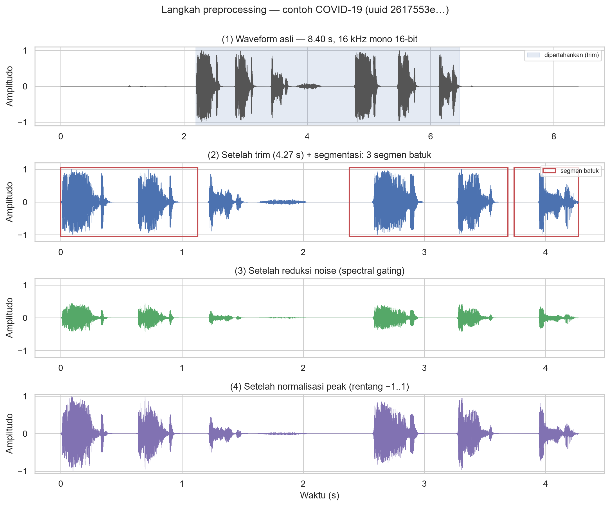
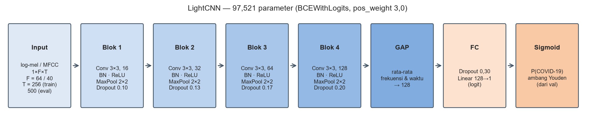

# BAB III METODOLOGI PENELITIAN

## 3.1 Alur Penelitian

Penelitian mengikuti *pipeline* pengenalan pola suara pada materi kuliah [9], yaitu
**akuisisi → *preprocessing* → ekstraksi fitur → klasifikasi → evaluasi** (Gambar 1). Satu prinsip berlaku di
seluruh tahap: **pembagian data (*split*) dilakukan paling awal**. *Undersampling*, SMOTE, augmentasi, *scaling*,
normalisasi *spectrogram*, dan seleksi fitur hanya di-*fit* pada data latih (*train*). Tujuannya mencegah kebocoran
informasi dari data validasi/uji ke dalam model. Semua sumber keacakan memakai *seed* 42.

**Gambar 1.** Diagram alur penelitian mengikuti *pipeline* pengenalan pola suara: akuisisi, *preprocessing*,
ekstraksi fitur, klasifikasi, dan evaluasi.

## 3.2 Akuisisi Data: Dataset COUGHVID v3

Data yang dipakai adalah COUGHVID v3 [5] (Zenodo *record* 7024894). Rekaman dikumpulkan
secara *crowdsourcing* melalui aplikasi web, sehingga direkam dengan mikrofon telepon pintar atau komputer
peserta dalam lingkungan yang tidak terkendali. Setiap rekaman berdurasi maksimal ±10 detik dan disertai berkas
metadata. Ringkasan dataset disajikan pada Tabel 2, sedangkan distribusi label dan demografinya ditunjukkan pada
Gambar 2.

**Tabel 2.** Ringkasan dataset COUGHVID v3 (hasil inspeksi data asli).

| Item | Nilai |
|---|---|
| Jumlah rekaman (= jumlah baris `metadata_compiled.csv`) | 34.434 |
| Format audio | 29.348 `.webm`, 1.777 `.ogg`, 3.309 `.wav` |
| Codec / *sampling rate* asli | Opus 48 kHz mono (`.webm`/`.ogg`); `.wav` berisi PCM 16-bit atau AAC, 16/44,1/48 kHz |
| `status` (*self-reported*): *healthy* / *symptomatic* / COVID-19 / kosong | 15.476 / 3.873 / 1.315 / 13.770 |
| Lolos `cough_detected` ≥ 0,8 | 18.544 (53,9%) |
| Rekaman berlabel ahli (≥ 1 `diagnosis_*`) | 2.841 (3.224 anotasi) |
| Gender (male / female / other / kosong) | 12.850 / 7.682 / 132 / 13.770 |

<!-- sumber: reports/tables/01_ringkasan_angka.csv, 01_distribusi_kategori.csv, PROGRESS.md Tahap 1 -->

**Gambar 2.** Distribusi `status` (*self-reported*), `status_SSL`, gender, kondisi pernapasan, demam/nyeri otot,
dan usia pada metadata COUGHVID v3.

Hasil inspeksi juga menunjukkan bahwa ekstensi `.wav` tidak selalu sesuai isinya: sebagian berkas `.wav` ternyata
berisi codec AAC. Karena itu, seluruh berkas didekode dengan ffmpeg, tidak dibaca langsung sebagai PCM.

### 3.2.1 Kriteria inklusi

1. Skor `cough_detected` ≥ 0,8. Skor ini adalah probabilitas keluaran detektor batuk dari penyusun dataset, dan
   ambang 0,8 direkomendasikan penyusun dataset [5].
2. Label yang relevan untuk tiap eksperimen tersedia (Subbab 3.2.2).
3. Rekaman dapat didekode dan berdurasi ≥ 0,3 detik setelah *trimming*. Sebanyak 17 rekaman gugur pada kriteria ini.

### 3.2.2 Skema label

- **Eksperimen A (utama), label *self-reported*:** `status` = COVID-19 (kelas positif, 1) vs *healthy* (0).
  Populasinya 720 COVID-19 dan 10.132 *healthy* (rasio ±1:14). Kelas *symptomatic* (2.683 rekaman lolos ambang)
  tidak dipakai karena bukan negatif yang jelas.
- **Eksperimen B (keandalan label), label ahli:** subset yang dianotasi pulmonolog (`diagnosis_1..4`). Label
  ditentukan dengan *majority vote* antar-ahli: COVID-19 (1) vs *healthy_cough* (0). Rekaman dengan suara seri
  dibuang (36 rekaman). Dari 130 rekaman yang dinilai lebih dari satu ahli, 124 mengandung ketidaksepakatan.
  Setelah filter `cough_detected` ≥ 0,8 diperoleh 470 COVID-19 dan 543 *healthy*.
- Label `status_SSL` (hasil *semi-supervised learning* penyusun dataset) tersedia sebagai Eksperimen C opsional,
  tetapi tidak dijalankan pada penelitian ini.

### 3.2.3 Pembagian data

COUGHVID tidak menyediakan ID subjek. Karena itu, pembagian dilakukan per rekaman (`uuid`) secara **terstratifikasi
70/15/15** (train/val/test, *seed* 42) **sebelum** *preprocessing* lanjutan. Pembagian Eksperimen A dan B dibuat
terpisah. Agar komputasi di CPU tetap layak, kelas *healthy* pada **train A saja** di-*undersample* secara acak ke
rasio *healthy* : COVID-19 = 3 : 1. Val dan test dipertahankan pada **distribusi alami** (±1:14) agar evaluasi
mencerminkan kondisi skrining nyata (Tabel 3, Gambar 3).

**Tabel 3.** Jumlah rekaman per *split* dan kelas setelah *preprocessing* (COVID-19 / *healthy* / total).

| Split | Eksperimen A | Eksperimen B |
|---|---|---|
| Train | 502 / 1.507 / 2.009 (populasi penuh: 504 / 7.092) | 329 / 378 / 707 |
| Val | 108 / 1.514 / 1.622 | 71 / 81 / 152 |
| Test | 108 / 1.516 / 1.624 | 70 / 82 / 152 |
| **Total** | **718 / 4.537 / 5.255** | **470 / 541 / 1.011** |

<!-- sumber: reports/tables/02_jumlah_per_split_A.csv, 02_jumlah_per_split_B.csv -->

**Gambar 3.** Jumlah rekaman per *split* dan kelas untuk Eksperimen A (*train* di-*undersample* 3:1) dan
Eksperimen B.

## 3.3 *Preprocessing*

*Preprocessing* dijalankan per berkas secara paralel (11 *worker*, ±258 detik untuk 5.831 berkas). Urutan langkah
dan parameternya disajikan pada Tabel 4, sedangkan contoh hasilnya ditunjukkan pada Gambar 4.

**Tabel 4.** Langkah dan parameter *preprocessing*.

| Langkah | Metode | Parameter |
|---|---|---|
| a. Konversi & *resampling* | ffmpeg | WAV mono, $f_s$ = 16 kHz (Nyquist 8 kHz), PCM 16-bit (65.536 level) |
| b. *Trimming* hening awal/akhir | `librosa.effects.trim` | `top_db` = 30 dB, *frame* 512, *hop* 128 |
| c. Segmentasi batuk | Ambang ganda RMS (adaptasi `segment_cough` COUGHVID) | *frame* 25 ms, *hop* 10 ms, $T_h$ = 2,0 × RMS global, $T_l$ = 0,5 × RMS global, toleransi 30 ms, *padding* 0,2 s, batuk minimum 0,2 s |
| d. Reduksi derau | *Spectral gating* stasioner (`noisereduce`) [20] | `prop_decrease` = 0,8 |
| e. Normalisasi amplitudo | *Peak normalization* | puncak → 0,99 |
| Pembuangan | – | durasi < 0,3 s setelah *trim*, berkas senyap/rusak |

<!-- sumber: config.yaml bagian preprocessing; PROGRESS.md Tahap 2 -->

Hasil segmentasi batuk (jumlah dan batas segmen) disimpan sebagai metadata. Fitur dihitung dari **sinyal penuh hasil
*trim***, karena segmentasi berbasis ambang RMS global tidak mendeteksi segmen pada 11,6% rekaman A. Normalisasi
*peak* per rekaman sengaja menghapus informasi kenyaringan absolut, karena *gain* mikrofon antar-perangkat tidak
seragam.

**Gambar 4.** Tahapan *preprocessing* pada contoh rekaman COVID-19: konversi 16 kHz mono, *trimming*, segmentasi
batuk, reduksi *noise*, dan normalisasi.

## 3.4 Ekstraksi Fitur

Ekstraksi fitur memakai librosa [21] dan spafe [22] dengan parameter *frame* bersama:
$N_\text{FFT}$ = 512 (32 ms, resolusi 31,25 Hz), *hop* 160 (10 ms), dan jendela Hann.

### 3.4.1 Fitur tabular (untuk ML klasik)

Setiap rekaman diringkas menjadi vektor **315 fitur**. Fitur-fitur ini diperoleh dari statistik (rata-rata,
simpangan baku, minimum, maksimum, dan untuk MFCC/GFCC juga *skewness* dan *kurtosis*) atas nilai per *frame*
(Tabel 5).

**Tabel 5.** Kelompok fitur tabular.

| Kelompok | Jumlah kolom | Isi |
|---|---|---|
| Domain waktu | 9 | durasi; RMS dan ZCR × 4 statistik |
| Spektral | 40 | *centroid*, *bandwidth*, *rolloff* (85%), *flatness* × 4 statistik; *contrast* 6 pita (5 oktaf dari 200 Hz) × 4 statistik |
| *Pitch* | 6 | $f_0$ (pYIN, 65–1000 Hz, *frame* 64 ms) × 4 statistik pada *frame voiced*; *voiced ratio*; rata-rata probabilitas *voiced* |
| MFCC | 78 | 13 koefisien (64 filter mel, 0–8 kHz, DCT-II) × 6 statistik |
| MFCC Δ dan ΔΔ | 52 + 52 | 13 koefisien × 4 statistik (lebar jendela delta 9 *frame*) |
| GFCC | 78 | 13 koefisien (40 filter gammatone/ERB, *pre-emphasis* 0,97, kompresi akar pangkat tiga, DCT) × 6 statistik |

<!-- sumber: config.yaml bagian features; PROGRESS.md Tahap 3 -->

Implementasi MFCC librosa tidak menerapkan *pre-emphasis*. Sebaliknya, implementasi GFCC spafe menerapkan
*pre-emphasis* dengan $\alpha$ = 0,97. Statistik $f_0$ bernilai kosong pada rekaman yang tidak memiliki *frame*
bersuara (14% rekaman A). Nilai tersebut diisi 0 menggunakan aturan deterministik per rekaman, sehingga tidak
memakai statistik dataset dan bebas kebocoran.

### 3.4.2 Fitur dua dimensi (untuk CNN)

Sinyal dipotong atau di-*pad* nol menjadi 10 detik, lalu dihitung dua representasi berikut.

- ***Log-mel spectrogram***: 64 pita mel (0–8 kHz), daya dalam dB, dipotong 80 dB di bawah puncak. Bentuknya
  64 × 1001 *frame*.
- **MFCC 2D**: 40 koefisien DCT dari *log-mel*. Bentuknya 40 × 1001 *frame*.

Untuk efisiensi CPU, setiap dua *frame* dirata-ratakan sehingga resolusi waktunya menjadi 20 ms (64 × 500 dan
40 × 500). Resolusi ini masih memadai untuk episode batuk yang berlangsung ±200–500 ms. Normalisasi *mean/std* per
pita frekuensi di-*fit* pada train saja.

## 3.5 Model Klasifikasi

### 3.5.1 ML klasik

Model ML klasik dibangun dengan scikit-learn [23], imbalanced-learn [24], dan XGBoost
[17]. Setiap model berbentuk *pipeline* `StandardScaler → SelectKBest(ANOVA F) → [SMOTE] → klasifier`.
Dengan susunan ini, *scaling*, seleksi fitur, dan *oversampling* di-*fit* ulang di dalam setiap *fold* validasi
silang. Enam model dibandingkan: *Dummy* (stratified, sebagai *baseline* acak), *Logistic Regression*, SVM *kernel*
RBF, k-NN, *Random Forest*, dan XGBoost. *Hyperparameter* dicari dengan `RandomizedSearchCV` (20 iterasi, skor
ROC-AUC) **pada train saja**. Eksperimen A memakai *StratifiedKFold* 5, sedangkan Eksperimen B memakai
*RepeatedStratifiedKFold* 5 × 3. Ruang pencariannya disajikan pada Tabel 6.

**Tabel 6.** Ruang pencarian *hyperparameter* model ML klasik.

| Model | Ruang pencarian |
|---|---|
| Semua | `select__k` ∈ {20, 50, 100, semua} |
| *Logistic Regression* | $C$ ~ log-uniform(10⁻⁴, 10¹) |
| SVM (RBF) | $C$ ~ log-uniform(10⁻², 10²); $\gamma$ ~ log-uniform(10⁻⁴, 10⁻¹) |
| k-NN | $k$ ∈ [5, 150]; bobot ∈ {*uniform*, *distance*}; $p$ ∈ {1, 2} |
| *Random Forest* | `max_depth` ∈ {None, 5, 10, 20}; `min_samples_leaf` ∈ {1, 2, 5, 10, 20}; `max_features` ∈ {sqrt, 0,1, 0,3} |
| XGBoost | `max_depth` ∈ {2, 3, 4, 6}; *learning rate* ~ log-uniform(0,01; 0,3); `subsample` ∈ {0,6; 0,8; 1,0}; `colsample_bytree` ∈ {0,3; 0,5; 0,8}; `min_child_weight` ∈ {1, 5, 10}; `n_estimators` ∈ {100, 300, 500} |

<!-- sumber: src/models_ml.py fungsi param_space(); hyperparameter terpilih di Lampiran (04_imbalance_A/B.csv) -->

### 3.5.2 CNN ringan (LightCNN)

CNN diimplementasikan dengan PyTorch [25]. Arsitekturnya (Gambar 5) terdiri atas **4 blok konvolusi**.
Setiap blok berisi Conv 3×3 → *Batch Norm* → ReLU → MaxPool 2×2 → *Dropout*, dengan jumlah kanal 16-32-64-128 dan
*dropout* 0,10 → 0,20. Blok-blok tersebut diikuti *global average pooling*, *dropout* 0,30, dan satu neuron
keluaran. Total parameternya **97.521**. Rincian per lapisan ada di Lampiran.

**Gambar 5.** Arsitektur LightCNN (4 blok konvolusi 3×3, *global average pooling*, 97.521 parameter).

Pelatihan CNN memakai pengaturan berikut.

- **Fungsi *loss*:** *binary cross-entropy* berbobot,
  $\mathcal{L} = -\frac{1}{n}\sum_i \big[w_+\, y_i \log \hat{p}_i + (1 - y_i)\log(1 - \hat{p}_i)\big]$, dengan
  `pos_weight` $w_+$ = 3,0 sesuai rasio train.
- ***Optimizer*:** AdamW [26] (*learning rate* 10⁻³, *weight decay* 10⁻²), dengan *ReduceLROnPlateau*
  (faktor 0,5, *patience* 4) berdasarkan AUC val.
- **Batas pelatihan:** maksimal 100 *epoch*, *early stopping* berdasarkan AUC val (*patience* 10), *batch* 32.
- **Augmentasi (train saja):** *random crop* 256 *frame* (5,12 s) di area yang berisi suara, *time shift* ±20
  *frame*, dan SpecAugment [27] berupa 2 *frequency mask* dan 2 *time mask*. Val dan test memakai
  rekaman penuh tanpa augmentasi.
- **Pengulangan:** setiap konfigurasi (log-mel dan MFCC 2D) dilatih dengan tiga *seed* (42, 7, 2024). Baris utama
  hasil memakai *seed* 42, yang ditetapkan sebelum hasil dilihat. Rata-rata ± simpangan baku ketiga *seed*
  dilaporkan sebagai ukuran variabilitas.

### 3.5.3 Penanganan ketidakseimbangan kelas

- **ML klasik:** *undersampling* train A 3:1, lalu strategi dipilih per algoritma berdasarkan AUC CV antara
  (a) *class weight* `balanced` (XGBoost: `scale_pos_weight`) atau (b) SMOTE [28] di dalam *pipeline*.
- **CNN:** *undersampling* train A 3:1 + `pos_weight` = 3,0. *WeightedRandomSampler* tidak dipakai karena akan
  mengulang ±500 rekaman COVID-19 berkali-kali per *epoch* (risiko hafalan).
- **Evaluasi:** ambang keputusan dipilih di val, bukan 0,5, karena *undersampling* menggeser prior kelas sehingga
  probabilitas keluaran tidak terkalibrasi.

## 3.6 Protokol dan Metrik Evaluasi

Protokol evaluasi terdiri atas tiga tahap.

1. **Train:** *tuning* dan validasi silang. Variabilitas dilaporkan melalui *repeated stratified* CV 5 × 5.
2. **Val:** pemilihan ambang keputusan dengan **indeks Youden** $J = \text{sensitivitas} + \text{spesifisitas} - 1$
   [29] dan pemilihan model terbaik berdasarkan AUC val. Model tidak dilatih ulang dengan data val.
3. **Test:** setiap model final dievaluasi **satu kali**.

Dengan TP, TN, FP, dan FN sebagai unsur *confusion matrix* (kelas positif = COVID-19), metrik yang dipakai adalah:

$$\text{Accuracy} = \frac{TP + TN}{TP + TN + FP + FN}, \qquad
\text{Precision} = \frac{TP}{TP + FP},$$

$$\text{Sensitivitas (Recall)} = \frac{TP}{TP + FN}, \qquad
\text{Spesifisitas} = \frac{TN}{TN + FP},$$

$$F_1 = \frac{2 \cdot \text{Precision} \cdot \text{Recall}}{\text{Precision} + \text{Recall}}, \qquad
\text{Balanced Accuracy} = \frac{\text{Sensitivitas} + \text{Spesifisitas}}{2}.$$

**ROC-AUC** adalah luas di bawah kurva *true positive rate* terhadap *false positive rate* untuk semua ambang. Nilai
ini setara dengan probabilitas bahwa skor sebuah sampel positif acak lebih tinggi daripada skor sebuah sampel
negatif acak. ROC-AUC bernilai 0,5 untuk model acak dan tidak bergantung pada ambang maupun prevalensi. **PR-AUC**
(*average precision*) adalah luas di bawah kurva *precision–recall*. *Baseline* acaknya sama dengan prevalensi
(0,067 pada test A), sehingga PR-AUC lebih informatif daripada ROC-AUC pada data yang sangat tidak seimbang
[30]. **Akurasi tidak dipakai sebagai metrik utama**, karena model yang selalu menebak "*healthy*" sudah
mencapai akurasi ±93% pada test A.

Ketidakpastian dan signifikansi dihitung sebagai berikut.

- **Interval kepercayaan 95%** ROC-AUC dan PR-AUC dihitung dengan *bootstrap* 1.000 kali (persentil)
  [31].
- **Perbedaan AUC dua model** pada test yang sama diuji dengan **uji DeLong** untuk kurva ROC berkorelasi
  [32], menggunakan algoritma cepat Sun dan Xu [33], dan diverifikasi dengan *bootstrap*
  berpasangan 2.000 kali.
- **Kesepakatan dua sumber label** diukur dengan Cohen's κ [34].
- **Uji beda fitur univariat** (EDA, pada train saja) memakai uji Mann–Whitney [35] dengan koreksi
  Benjamini–Hochberg (FDR) [36]. Ukuran efeknya adalah *rank-biserial* $r = 2\cdot\text{AUC} - 1$.

Analisis tambahan mencakup ablasi kelompok fitur, *permutation importance* pada val, Grad-CAM [37]
untuk CNN, proyeksi PCA/t-SNE [38], analisis kesalahan, kinerja per subgrup demografi, dan **uji
silang label**. Pada uji silang label, model yang dilatih dengan label A dievaluasi pada data berlabel B dan
sebaliknya, setelah semua `uuid` train/val model sumber dibuang dari set evaluasi.

## 3.7 Lingkungan Komputasi

Seluruh eksperimen dijalankan pada komputer pribadi tanpa GPU. Spesifikasi perangkat, versi pustaka, dan waktu
komputasi tiap tahap dirangkum pada Tabel 7.

**Tabel 7.** Lingkungan komputasi.

| Komponen | Spesifikasi |
|---|---|
| Sistem operasi | Windows 11 (PowerShell) |
| Prosesor | AMD x86-64 (*Family* 25), 12 *thread* logis; **tanpa GPU NVIDIA** (pelatihan CNN di CPU) |
| Python | 3.11.2 (*virtual environment* `.venv`) |
| Pustaka audio | ffmpeg 9.1, librosa 0.10.2, soundfile 0.14.0, noisereduce 3.0.3, spafe 0.3.3 |
| Pustaka ML/DL | NumPy 1.26.4, pandas 2.3.3, scikit-learn 1.5.2, imbalanced-learn 0.14.2, XGBoost 3.2.0, PyTorch 2.15.0 (CPU) |
| Waktu komputasi | *Preprocessing* ±4,3 menit; ekstraksi fitur ±88 menit; ML klasik 14 menit (A) + 5,6 menit (B); CNN 73,3 menit (6 *run*) |
| Reprodusibilitas | *seed* 42 (NumPy, *random*, PyTorch, scikit-learn); parameter terpusat di `config.yaml` |

<!-- sumber: reports/logs/pip_freeze.txt; PROGRESS.md Tahap 1–5 -->
